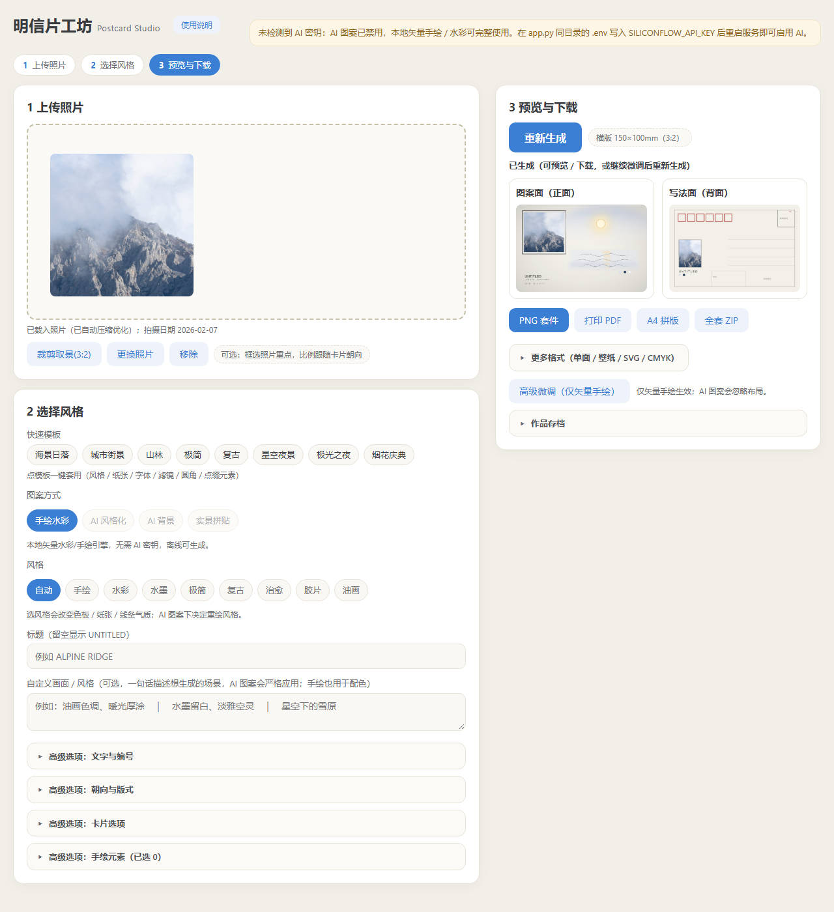

# Postcard Studio · 照片 → 明信片生成器

把一张照片自动设计成可打印的**双面明信片**：正面是照片 + 标题 + 色卡 + 水彩画区，
背面是标准邮寄面（邮编框、邮票位、地址线）。支持导出 600dpi PNG、带出血/裁剪线的
印刷 PDF、A4 拼版、CMYK 印前 PDF、手机壁纸，以及**矢量 SVG**。

> A local web app that turns a photo into a printable two-sided postcard.
> Front = photo + editorial metadata + a watercolor vector panel;
> back = mailing side. Exports 600dpi PNG, print-ready PDF (bleed + crop marks),
> A4 imposition, CMYK PDF, wallpaper, and vector SVG.



## 功能

- **3 个区块**：上传照片 → 选风格/图案 → 预览并下载；桌面左侧控制 + 右侧粘性预览，移动端单列。
- **两套渲染引擎**：
  - 位图引擎（Pillow）：按 DPI 真实高清渲染，适合 PNG / PDF 印刷导出；
  - 矢量引擎（纯 PIL + numpy）：把照片量化成色块并追踪轮廓，生成可按层编辑的 SVG 水彩画区。
- **8 套场景模板**、19 个内置手绘元素、10 种纸张、标题字体 / 粗斜体 / 滤镜 / 圆角 / 照片增强。
- **AI 可选**：SiliconFlow img2img 风格化与文生图背景；没有密钥时自动降级到纯本地矢量引擎，
  页面会明确提示，不会崩溃。
- **导出**：高清 PNG（600dpi）、打印版 PDF（3mm 出血 + 裁剪线）、A4 一张印 2 张、
  CMYK 印前 PDF、手机壁纸、矢量 SVG（ZIP 内含正/背面）、全套 ZIP 打包。
  **SVG 跟随当前图案**：AI 图案会先把图生图结果矢量化为画区，本地水彩则直接矢量化原图。
- **画布编辑**：拖动 / 缩放 / 旋转 / 置顶置底 / 撤销重做；作为"高级微调"入口，不占主流程。
- **拍摄日期**：从原始 JPEG 读取 EXIF `DateTimeOriginal`，自动预填日期输入并可印在卡片上。

## 快速开始（Windows）

需要 Python 3.10+（开发/验证环境为 Python 3.14.3）。

```powershell
cd <项目目录>
python -m pip install -r requirements.txt
```

然后任选一种启动方式：

```powershell
# 方式 A：一键启动（推荐；自动探测装了依赖的 Python，带崩溃重启）
powershell -ExecutionPolicy Bypass -File .\start-service.ps1

# 方式 B：双击 启动明信片.bat（默认仅本机；--tunnel 才开 Cloudflare 隧道）
```

打开 <http://127.0.0.1:5179>。日志在 `app.log` / `app.err.log`。

也可以手工运行：

```powershell
python app.py
```

> 修改 Python 代码后需要重启服务；`index.html` 由服务端实时读取，改完刷新页面即可。

## AI 配置（可选）

```powershell
copy .env.example .env
# 编辑 .env，填入 SILICONFLOW_API_KEY
```

AI 只用于**图像生成**，不再做元素识别：

- **AI 风格化**（img2img）：`Qwen/Qwen-Image-Edit-2509`；
- **AI 背景**（text-to-image）：`Kwai-Kolors/Kolors` 或 `Tongyi-MAI/Z-Image-Turbo`；
- 实景拼贴（zine）也走 img2img；
- 没有 SiliconFlow key 时，AI 图案选项会禁用，所有导出自动使用本地矢量引擎，并在页面提示。

`GET /status` 的 `models.generation` 告诉前端当前是否支持 AI 生图。

## 项目结构

```
app.py                  Flask + waitress 后端（/generate /export /bundle）
index.html              单文件前端（无框架、无构建）
make_postcard.py        位图渲染引擎（构图、元素、文字、PDF、CMYK、A4 拼版）
make_postcard_svg.py    矢量 SVG 引擎（照片量化、轮廓追踪、evenodd 孔洞、水彩画区）
selftest.py             回归自检（渲染 + 像素判据 + 端到端 HTTP + 前端静态约定）
requirements.txt        5 个运行时依赖
start-service.ps1       带崩溃重启的服务启动器
启动明信片.bat           一键启动（双击）
find-python.ps1         探测装了依赖的 Python
scripts/render_benchmarks.py  渲染基准卡并输出多边形统计
docs/ITERATION_LOG.md   36 轮画区迭代历史与教训
docs/CHANGELOG.md       本版本修复清单
fonts/README.md         字体（MiSans 未随仓库分发）说明
```

照片、缓存、证据截图、第三方技能包、字体文件都**不在仓库内**（见 `.gitignore`）。

## 测试

```powershell
python selftest.py --quick   # 100 项，约 30s
python selftest.py           # 102 项，完整（含 600dpi / 并发压力）
```

自检不需要 AI 密钥，也不需要先启服务：它会在 5199 端口起一个进程内实例
（可用 `POSTCARD_TEST_PORT` 改端口），失败时退出码为 1。仓库不包含作者的示例照片：
如果 `photo-A.img` 不存在，自检会生成一张合成的雾山样片，保证全新克隆也能直接跑。

覆盖范围：渲染正确性与像素级判据、像素级负向对照、全部导出端点、脏参数降级、
无密钥降级、并发、SVG 转义/孔洞/长宽比、前端标签与交互约定。

### 基准卡

`scripts/render_benchmarks.py` 可以渲染五张基准卡（需要自备照片），并输出
tone / EDGE 多边形数与文件大小。当前基线见 [docs/BENCHMARKS.md](docs/BENCHMARKS.md)。

## API

| 方法 | 端点 | 说明 |
|---|---|---|
| GET | `/` | 前端页面 |
| GET | `/status` | `{ai_key, blocked, models}`（models.generation 表示 AI 生图是否可用） |
| POST | `/generate` | 照片 + 参数 → 正/背面 base64 预览 |
| POST | `/export` | `kind=front-hi/front-pdf/back-hi/back-pdf/sheet-pdf/sheet-pdf-back/pngset/wallpaper/print-cmyk/svg` |
| POST | `/bundle` | 全套 ZIP（PNG ×2 + 打印 PDF ×2 + A4 拼版 + 使用说明） |

参数白名单见 `app.py` 的 `OPTION_KEYS`；`date` 为新增可选字段（前端从 EXIF 自动填充）。
`/export kind=svg` 返回 **ZIP**（内含 `postcard-front.svg` / `postcard-back.svg`；AI 图案会把图生图结果矢量化，若 AI 不可用则回退原图并附带 `ai_note.txt`）。

## 设计说明与已知限制

- 卡片规格：横版 **150×100mm（3:2）**；竖版 100×150mm 仅在 AI 图案方式下生效，
  矢量 SVG 固定横版；背面始终横版。
- 打印 PDF 含 3mm 出血与裁剪线；专业胶印请用 CMYK 印前 PDF。
- 矢量 SVG 是 ZIP（正/背面两个文件），不是单个 `.svg`。
- 竖版 / 方向参数不会改变矢量 SVG 布局。
- 水彩画区是"照片量化 + 轮廓追踪"的矢量平涂，参数空间已探明；R1 类极繁忙街景
  仍是该架构的难点，详见 `docs/ITERATION_LOG.md`。
- 纯 Python 回退（没有 numpy）可用但慢，网格会自动降低以控制内存。
- Windows 启动脚本（`.ps1` / `.bat`）为 Windows 专用；核心应用也可在 macOS/Linux 上
  `python app.py` 运行。CJK 字体自动探测系统字体（Windows SimSun/SimHei、Linux Noto CJK、
  macOS PingFang），也可用 `POSTCARD_FONT_DIR` 指定字体目录，或按 `fonts/README.md` 放置 MiSans。

## 安全与隐私

- 默认只监听 `127.0.0.1`；CORS 只允许同源与 `file://`，其它 Origin 的写请求返回 403。
- 上传限制 50MP；服务端不把异常原文回给客户端。
- Cloudflare 隧道默认**关闭**，需要 `--tunnel` 或 `POSTCARD_TUNNEL=1` 显式开启；
  开启前请自行配置 Cloudflare Access 等鉴权（本项目自身没有登录系统）。
- `cache/` 保存 AI 结果，启动时按 14 天 TTL / 300MB 上限清理；用户照片不会提交到仓库。
- `.env`、`.python-path`、`*.pem` 等已排除在版本控制之外。

## License

MIT，见 [LICENSE](LICENSE)。

第三方说明：MiSans 字体不随仓库分发（见 `fonts/README.md`）；仓库不包含任何第三方
技能文档、示例照片或用户上传内容。AI 服务由 SiliconFlow 提供，使用需遵守各自服务条款。
